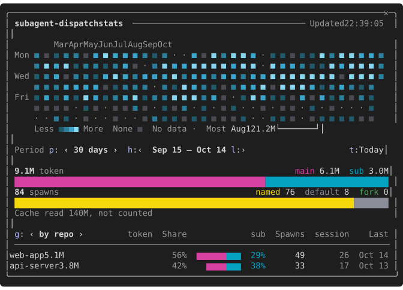
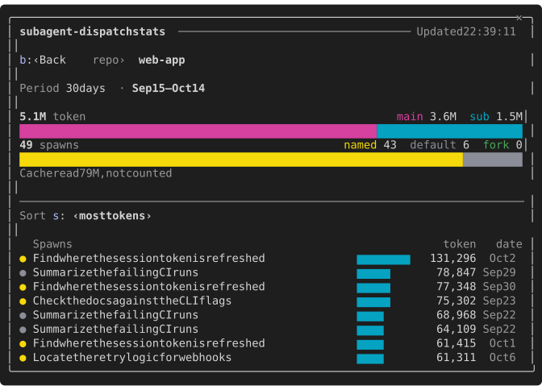

# subagent-dispatch

[English](subagent-dispatch.md) | 繁體中文 · [所有 mod](../../README.zh-TW.md#mods)

被中斷的背景 agent 按一個鍵就重派，並列出 token 花在哪：主 session 與 subagent 的比例，依 repo、session、模型、agent 種類，一路到每一次派出。

| 用模型 | CLI | Desktop | 雲端 |
| --- | --- | --- | --- |
| 否 | 是（手機只有狀態列） | 是 | 否 |

## 重派

背景 agent 被中斷時在輸入框上方顯示：按 `[重派]`（`r`）或 `/subagent-dispatch redispatch` 把重派指示（各 agent 原本的 prompt、種類與模型）放進輸入框，或按 `[略過]`（`d`）。agent 執行中不顯示。

## 指令

| 指令 | 做什麼 |
| --- | --- |
| `/subagent-dispatch redispatch` | 把被中斷 agent 的重派指示放進輸入框 |
| `/subagent-dispatch stats [--text] [天數]` | 開用量 pane（見下方） |
| `/subagent-dispatch backfill` | 重新把還沒有帳本的 session 的 transcript 補成帳本（見[回填](#回填)） |
| `/subagent-dispatch status`、`set`、`unset` | 查看與修改設定 |

## 用量帳本

每個 session 在 plugin 自己的 `$.store` 寫自己的帳本（每個 session 一個 key，跨 repo 共用），記下：

- session：所屬 repo（用主工作樹，同 repo 的 worktree 歸在一起）、開始時間與第一則非 `/` 指令 prompt 的前 40 字（兩者合起來當 session 名稱，例如 `10/12 02:11 檢查 diff…`），以及主 session 每天各模型的 token（依本機日期）。`/clear` 後的新 session 有自己的開始時間與名稱；mod 讀不到 session 本身的標題。
- 每次派出（每個 session 保留最近 500 筆）：description、agent 種類、呼叫指定的模型（或預設）與實際的模型、是不是 fork、是不是背景、input／cache write／cache read／output token、步數與耗時。帳本沒看到派出的 agent（例如熱重載前派的）列為 `unknown`。

90 天沒有寫入的帳本在 session 開始時刪除。0.4.0 之前的帳本沒有分日，它的主 session token 全部算在最後寫入的那天。

刪除之前，同一次 session 開始時會把已經結束的日子（前天以前）各算成一行每日摘要：所有 session 合計的主 session 各模型 token、派出各模型 token 與派出次數。每一行都從帳本整個重算、只寫一次，保留 366 天，所以帳本刪除後，熱圖仍看得到一年內的每一天。

`/subagent-dispatch stats [天數]`（1–90，預設 30，照日曆天算、含今天）開 pane，涵蓋所有 session：主 session 只算期間內那幾天的 token，派出依最後一步的日期算，跨午夜的派出整筆算在最後一步那天。

圖是實際的 pane 配上假資料，用 `scripts/capture-pane.py` 擷取（畫面文字是英文）。

- 最上面一行是 `subagent-dispatch stats`，後面一條橫線，最右邊是 pane 上次讀取帳本的時間（`更新於 19:04:05`，放不下時只寫時間）。提示列在 dock 的 pane 置底，只列按鈕上沒畫出的鍵（`Tab`、`Enter`、`Esc`）。
- 總覽最上面是日曆熱圖，一格一天、一欄一週，週一在最上面，今天落在最後一欄：寬度放得下幾週就畫幾週，最多 53 週（80 欄 38 週、110 欄起 53 週，不到 12 欄不畫）。每格是當天的 token（主 session 加 subagent，不算快取讀取）：沒有紀錄的日子（回填以前、transcript 已刪、別台電腦）是灰色 `·`，有紀錄但沒有用量是灰色 `■`，有用量依畫出來的日子分四分位、青色越亮越多。格子的顏色只表示用量，不跟著期間改變。上方標月份，左邊標 `一`／`三`／`五`。格子下面一行用括號 `└── 30 天 ──┘` 標出期間涵蓋的週；期間 1 天時那格變成橘色，下面寫 `▲ 10/02（五）`。同一行放得下多少就放多少圖例：`少 ■■■■ 多`、`無用量 ■`、`無資料 ·`、用量最多的那天（`最多 10/02 1.2M`），被括號擋到時移到括號右邊。最近 89 天讀帳本，跟 pane 其他地方的算法一樣；更早的讀每日摘要。desktop 畫成一張 Svg，括號與 `▲` 畫在 Svg 裡，圖例在下面一行。
- 熱圖下面是期間：`期間 p: ‹ 30 天 ›  h: ‹ 09/13 – 10/12 l: ›`，最右邊是 `t: 今天`。`p` 依序切換 1／7／30／90 天，期間的最後一天不變；`h`／`l` 一次往前／往後移一個期間長度（1 天移 1 天、7 天移一週），`l` 到今天為止，`h` 到 366 天前為止；`t` 直接跳到今天這 1 天。格子不能點。太窄時先拿掉「期間」，再把日期縮成 `09/13–10/12`。
- 摘要不用卡片框，token 和派出各兩行：第一行左邊是總數（`12M token`、`46 次派出`），右邊是組成（`主 8.4M  sub 4.0M`；`指定 14  預設 24  fork 8`，指定是呼叫時指定了模型、預設是沿用預設模型、fork 用主 session 的模型），第二行是填滿整行的長條。下面一行是 `快取讀取 182M 另計`。token 是 input + cache write + output。沒有派出時不畫派出那兩行。
- 期間沒有用量或沒有紀錄時，摘要的位置改成一句 `10/11（日）沒有用量。` 或 `09/20 – 09/26 沒有資料。`，不畫清單。期間全在帳本保存的 90 天以前時，摘要照畫（取自每日摘要），清單的位置說明詳細資料已刪除。整份用量都還沒有紀錄時，改用說明怎麼開始記錄的長句。
- 清單依 repo（顯示資料夾名稱）、session、模型或 agent 種類分組，一列一行。欄名列最左邊是分組切換鈕（`g: ‹ 依 repo ›`），下面一條橫線。欄位是名稱、token、佔比、長條（主 session 紫、subagent 青）、sub 佔比、派出、指定/預設/fork、分組自己的兩欄、快取讀取；分組自己的兩欄是：repo 的 session 數與「上次」、session 的 repo 與開始時間、模型與種類的每次派出平均 token 與「上次」。「上次」是期間內這一列最後一次有 token 用量的日期。寬度不夠時從最不重要的欄位開始拿掉（快取讀取、指定/預設/fork、分組自己的兩欄、sub、佔比、長條，最後剩 token 與派出），名稱至少留 16 欄；大約 100 欄全部放得下。依 session 分組時名稱是第一則 prompt。先列 10 列，按 `還有 N 筆`（`m`）再列 10 列。
- `期間`、`分組`、`排序` 都在原地切換，下方內容不會位移：終端機是一個顯示 `‹ 值 ›` 的按鈕，按下換到下一個值、到尾端繞回（快捷鍵 `p`、`g`、`s`）；desktop 是一個值一顆的分段按鈕，同一個快捷鍵放在目前值的下一顆上。
- 按一列的名稱打開它：最上面是 `b: ‹ 返回` 與麵包屑（`模型 ›` 加這一列的名稱，只有名稱會截斷），接著一行只顯示的期間（`期間 30 天 · 09/13 – 10/12`），再來是這一列自己的摘要（格式同總覽）；打開一個 session 時，token 那行右邊依主 session 用到的各模型列出。橫線下是 `排序` 與每次派出的表格（圓點顏色表示模型怎麼來、description、長條、token、日期），預設 token 多的在前，`排序` 可改成時間新的在前或耗時長的在前。先列 10 筆，按 `還有 N 筆`（`m`）再列 10 筆。按一筆派出會在原地展開它的種類、模型、執行（背景、步數、耗時）與 session，一次展開一筆。沒有派出的列（種類分組的「主 session」，或只有主 session 用過的模型）改用同樣的表格列出這些 token 來自哪些 session（prompt、長條、token、開始日期），可依 token 或時間排序。`b` 回總覽。
- 清單上下相鄰的長條用 `▆` 畫，兩列之間留一道空隙。
- pane 開著時會跟上新的用量：記下一個 step 或派出後一秒，依 ledger 重畫一次。其他原因的重畫（縮放、按鍵）距上次讀取不到 30 秒時沿用上次讀到的內容，所以 `更新於` 是上次讀取 ledger 的時間；別的 session 的用量在下次讀取時出現。

終端機較窄時 pane 會改放在輸入框上方。`/subagent-dispatch stats --text [天數]` 印出同樣內容的文字版；`-p` 執行或無處放 pane 時，`stats` 也改印文字版。

不含：各 mod 自己呼叫模型（`$.model.fork` / `$.model.complete`）的用量、雲端 session（不載入 mod），以及安裝時這台電腦已經沒有 transcript 的 session。

## 回填

Claude Code 沒有安裝事件，所以第一個開始時發現 store 裡沒有 `backfill` 標記的 session（`-p` 執行除外）會在背景讀本機的 transcript，session 不等它結束。設定資料夾 `projects/` 底下（`$CLAUDE_CONFIG_DIR`，沒設定時是 `~/.claude`）每個還沒有帳本的 session，都從它的 transcript 和 subagent 的 transcript（`<session>/subagents/agent-*.jsonl` 與 `.meta.json`）重建一本帳本：開始與最後寫入的時間、第一則 prompt、repo、主 session 每天各模型的 token（同一則回覆拆成好幾行只算一次），以及每次派出的種類、指定的模型、fork、背景、token 與步數。已經有帳本的 session 和目前的 session 以即時記錄為準。一次處理一個檔案；超過 4 MiB 的檔案改用 `cat` 讀（沒辦法執行程式的環境如 desktop 會略過），讀取失敗的檔案略過並記進 debug log。最後算出每日摘要，跳 toast 說補了幾個 session（`subagent-dispatch：已從 transcript 補上 221 個 session（9/15 起）`）；沒補到就不跳。

某個 session 執行回填時，標記是 `running`，其他 session 在 10 分鐘內不會再跑。`/subagent-dispatch backfill` 不管標記都重跑一次，給中途停掉或換電腦時用。`ledger` 關閉時不執行。

## 設定

| key | 預設 | repo 檔案 | 意思 |
| --- | --- | --- | --- |
| `ledger` | 開 | 不能設定 | 記錄派出與 token 用量。關閉後不再記錄，`stats` 仍讀得到已有的紀錄 |

`/config` 看不到 `ledger`，用 `/subagent-dispatch set ledger false --local` 或寫在 `~/.claude/cc-mod-trimtab.json`。分層見[設定](../settings.zh-TW.md)。

## 已知限制

- 回填只讀這台電腦的 transcript，而 Claude Code 預設 30 天後刪除 transcript（`cleanupPeriodDays`）：更早的日子維持「無資料」。
- `■` 與 `▆` 是 East Asian Ambiguous 寬度的字元：終端機設成「ambiguous 當全形」時，熱圖的格子與清單的長條會錯位。
- 「背景」是 Claude Code 對每次派出回報的值。所有 Agent 呼叫都在背景執行的環境（Agent 工具立刻返回）裡，每次派出都會列為背景。
